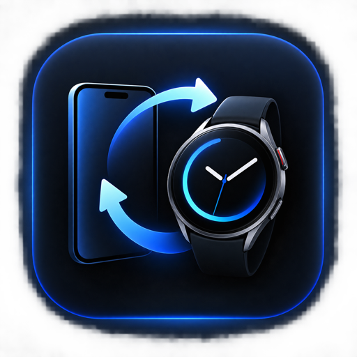

<p align="center">
  
</p>

<h1 align="center">Bridge</h1>

<p align="center">
  <b>Use a Wear OS watch with an iPhone.</b><br>
  Notifications, calls, music, battery, contacts and Find My Phone, over Bluetooth LE.<br>
  Local only: no cloud, no account, no analytics.
</p>

<p align="center">
  
  
  
  
  
</p>

---

Wear OS watches officially don't work with iPhones. Bridge connects them anyway, using **only public
APIs and Apple's documented Bluetooth services**. The watch reads iPhone notifications **directly from
iOS over ANCS** (Apple Notification Center Service), so notifications keep working even when the iPhone
companion app is suspended or closed.

Developed and tested on a **Galaxy Watch4 Classic LTE** (Wear OS / One UI Watch) paired with an
**iPhone 16 Pro**.

> [!WARNING]
> This is a work-in-progress personal project, **not a finished product**. Pairing, notifications,
> calls and media are verified on real hardware, but several reliability tests (reboots, out of range,
> second-device replacement) are still open. See [docs/STATUS.md](docs/STATUS.md).

## Features

| Feature | Status | How |
|---|---|---|
| iPhone notifications on the watch | ✅ Verified | ANCS, read directly by the watch. App logos, conversation grouping, per-app filters, content hiding for finance apps, optional 24 h history |
| Incoming calls: Answer / Decline | ✅ Verified | ANCS actions. Call audio stays on the iPhone |
| End an active call | 🧪 Experimental (off by default) | Undocumented ANCS "active call" category |
| Call screen extras | ✅ | Silence on the watch, shake to decline, bezel to answer, in-call timer |
| Media controls | ✅ Verified | Apple Media Service (AMS): play/pause/skip, bezel volume, track info, progress |
| iPhone battery and model on the watch | ✅ Verified | Standard Battery and Device Information services |
| Watch battery on the iPhone, low-battery alerts | ✅ | Both directions, charging-aware |
| Contacts on the watch | ✅ Verified | Synced by the iPhone app, stored encrypted on the watch. Search, favorites, call from iPhone |
| Find iPhone / Find watch | ✅ Verified | Ring either device from the other |
| Tile | ✅ | Media-first tile with connection and battery state |
| Secure app pairing | ✅ Verified | Approved on the watch. Every bridge message is sealed with AES-GCM and is replay-safe |
| Replying to messages, health sync, call audio on the watch | ❌ / ⏸ | Not possible with public iOS APIs, or not started. See the [capability matrix](docs/CAPABILITY_MATRIX.md) |

Read the **[capability matrix](docs/CAPABILITY_MATRIX.md)** before expecting a feature: much of what
an Android phone gives a watch is simply not available from iOS's public APIs.

## How it works

```
        iPhone (BLE central)                          Wear OS watch (BLE peripheral)
 ┌──────────────────────────────┐              ┌─────────────────────────────────────┐
 │ iOS system services          │◀─ GATT ──────┤ ANCS client  (notifications, calls) │
 │  ANCS · AMS · Battery · Time │   client     │ AMS client   (media)                │
 │                              │              │ Battery / device info               │
 │ Bridge companion app ────────┼─ GATT ──────▶│ Bridge GATT service (encrypted)     │
 │  (settings, contacts, Find)  │   client     │  settings · contacts · find · status│
 └──────────────────────────────┘              └─────────────────────────────────────┘
              one Bluetooth LE link, LE Secure Connections bond
```

- The watch advertises while disconnected. The iPhone connects and bonds; after that, iOS reconnects
  at system level by itself.
- Over the same link, the watch acts as a GATT client of iOS's built-in services (ANCS, AMS, Battery),
  and the iPhone app talks to the watch's own **Bridge service** for everything iOS doesn't provide.
- Bridge messages use an app-level key exchange (ECDH P-256 + HKDF) and AES-GCM, with cross-platform
  test vectors shared between CryptoKit and the JVM.

More: [architecture](docs/ARCHITECTURE.md) · [Bridge BLE protocol](docs/BLE_PROTOCOL.md) ·
[ANCS notes](docs/ANCS.md) · [security](docs/SECURITY.md) · [pairing lifecycle](docs/PAIRING_LIFECYCLE.md)

## Repository layout

| Path | What |
|---|---|
| [`wearos/ancs`](wearos/ancs) | Pure Kotlin ANCS protocol and session (unit-tested) |
| [`wearos/ams`](wearos/ams) | Pure Kotlin Apple Media Service protocol and Now Playing model (unit-tested) |
| [`wearos/protocol`](wearos/protocol) | Bridge GATT framing, messages and encryption, shared with iOS (unit-tested) |
| [`wearos/app`](wearos/app) | Wear OS app (Compose for Wear OS): BLE peripheral and GATT client, connection state machine, notifications, calls, media, contacts, tile |
| [`ios/`](ios) | SwiftUI companion app (target `PairingPOC`, shown as "Bridge"): onboarding, pairing, settings, contacts, Find, diagnostics |
| [`docs/`](docs) | Design docs, capability matrix, risk register, test plan, QA reports |

## Requirements

| | |
|---|---|
| Watch | Wear OS 3+ (API 30+). Developed on a Galaxy Watch4 Classic |
| iPhone | iOS 18+ |
| Watch build | JDK 17, Android SDK (compileSdk 37). Gradle 9.8 is fetched by the wrapper |
| iPhone build | macOS with Xcode (Swift 6), [XcodeGen](https://github.com/yonaskolb/XcodeGen) (`brew install xcodegen`) |

## Build and install

### Wear OS app

```bash
cd wearos
echo "sdk.dir=$HOME/Library/Android/sdk" > local.properties   # your Android SDK path
./gradlew :ancs:test :ams:test :protocol:test :app:testDebugUnitTest   # unit tests
./gradlew :app:installProfiling   # optimized build on a connected watch
```

Enable **Developer options → ADB debugging / Wireless debugging** on the watch and connect with
`adb pair` / `adb connect` first. Prefer the `profiling` build on real hardware: debug builds are
noticeably janky on a Watch4. `./gradlew :app:assembleDebug` builds a debug APK.

### iPhone app

```bash
cd ios
xcodegen        # generates Bridge.xcodeproj from project.yml
open Bridge.xcodeproj
```

Set your Apple Developer team under **Signing & Capabilities** (or `DEVELOPMENT_TEAM` in
`ios/project.yml`), then run the `PairingPOC` scheme on your iPhone. A free personal team works, but
its installs expire after 7 days and it can't sign Time Sensitive notifications (used by Find iPhone).

Unit tests run on the simulator:

```bash
xcodebuild test -project Bridge.xcodeproj -scheme PairingPOC -destination 'platform=iOS Simulator,name=iPhone 17 Pro'
```

### Pairing

1. Install and open Bridge on the watch, then tap **Pair iPhone**. The watch starts advertising.
2. Open Bridge on the iPhone and follow onboarding. Pairing goes through the app because iOS Settings
   doesn't list the watch.
3. Confirm the Bluetooth pairing code on both devices, then approve the app on the watch.
4. On the iPhone, allow **Share System Notifications** for the watch so ANCS works.

If pairing gets stuck on a stale bond, use *Forget This Device* in iOS Bluetooth settings and pair again.
The iOS and watch apps must be updated together because the bridge protocol is versioned and sealed.

## Privacy

- Notifications, contacts and settings move only between your iPhone and your watch, over an
  encrypted Bluetooth link. Nothing is sent to a server.
- **One network exception:** to show real app icons, the iPhone app looks up apps that notified the
  watch on Apple's public App Store lookup service. It sends only bundle IDs, and only to Apple.
- Contacts are stored encrypted on the watch (Android Keystore). Logs redact notification content.

## Known limitations

- Can't reply to messages, silence the iPhone ringer or route call audio to the watch (no public iOS
  API). See the [capability matrix](docs/CAPABILITY_MATRIX.md).
- Find iPhone can't reach an iPhone app that was force-quit.
- On One UI Watch, pop-up style is chosen by the system (full screen over the watch face).
- Reboot, out-of-range and long-run reliability tests are still open ([test plan](docs/TEST_PLAN.md),
  [risk register](docs/RISK_REGISTER.md)).
- The QA reports in `docs/` reference raw device logs and screenshots that are kept out of this
  repository because they contain device identifiers.

## Third-party assets and trademarks

App logos come from [Simple Icons](https://simpleicons.org) (CC0) and UI glyphs from Material Icons
(Apache 2.0); see [THIRD_PARTY.md](docs/THIRD_PARTY.md). All app names and logos are trademarks of
their owners and are used only to identify where a notification came from. This project is not
affiliated with Apple, Google or Samsung. "iPhone" is a trademark of Apple Inc.; "Wear OS" of
Google LLC; "Galaxy Watch" of Samsung.

## License

[MIT](LICENSE)
